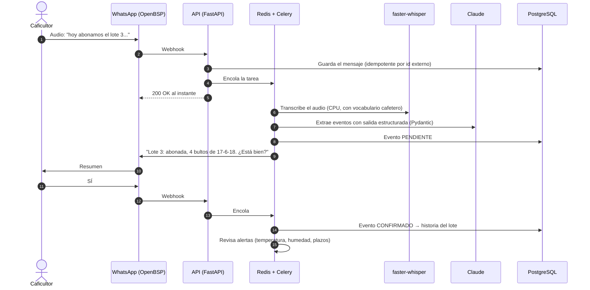
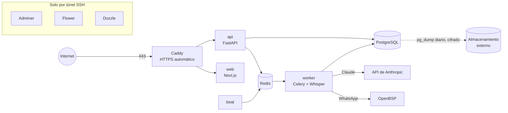

# Bitácora de Café

[](https://github.com/Julianoviedo-boop/BITACORA-CAFE/actions/workflows/ci.yml)
[](https://github.com/Julianoviedo-boop/BITACORA-CAFE/actions/workflows/publicar.yml)

**El caficultor le cuenta a WhatsApp lo que hizo en su lote, con un audio o un texto. El sistema lo transcribe, saca los datos, se los confirma y arma la historia del lote para la trazabilidad.**

> *"Hoy abonamos el lote La Esperanza con 4 bultos de 17-6-18"*
>
> → **Lote La Esperanza: abonada, hoy, 17-6-18, 4 bultos. ¿Está bien? Responde SÍ o dime qué cambiar.**

## El problema

En una finca cafetera se abona, se fumiga, se recolecta, se fermenta y se seca, pero casi nada queda anotado. Sin ese registro no hay trazabilidad para certificaciones ni para compradores de cafés especiales, y es difícil saber qué funcionó en cada lote.

Las apps de registro fallan en campo por lo mismo: piden formularios, buena señal y tiempo. El caficultor ya usa WhatsApp todos los días y prefiere hablar que escribir. Bitácora de Café no le pide nada nuevo: manda una nota de voz como se la mandaría al asesor, y el sistema hace el resto.

## Cómo funciona



Lo que hace que funcione en el mundo real:

- **Nada se guarda sin un SÍ explícito.** Un evento nace *pendiente* y solo pasa a *confirmado* con la respuesta del caficultor. Si falta un dato, se pregunta (una sola pregunta a la vez); si corrige ("no, fueron 5 bultos"), se actualiza el pendiente.
- **Webhook rápido e idempotente.** Responde en milisegundos y deja lo pesado a Celery; si WhatsApp reintenta, el mensaje no se procesa dos veces.
- **Multi-organización desde la base.** Cada consulta exige `organization_id`; las claves foráneas compuestas impiden mezclar datos entre asociaciones, y hay pruebas que lo verifican.
- **Reglas del café en YAML, no en el código.** Los tipos de evento, las etapas, las alertas y los límites viven en [`config/`](config/) y se validan al arrancar: un agrónomo puede ajustarlos sin programar.
- **Alertas por valor y por tiempo.** "La fermentación pasó de 24 °C" o "12 horas fermentando sin volteo", respetando la ventana de 24 horas de WhatsApp.
- **Panel para la asociación.** Lotes con su etapa y alertas, la historia de cada lote en una línea de tiempo con lo que dijo el caficultor, y gráficas de temperatura y humedad.
- **Trazabilidad para el comprador.** Un reporte en PDF con QR (desde el panel o escribiendo `REPORTE LOTE 3` por WhatsApp) y una página pública por lote, sin clave. Solo muestran lo confirmado y lo que la asociación marcó como público; lo que falta dice «No registrado», nunca se estima.
- **Protección de datos y de costos.** Autorización de tratamiento de datos antes de procesar nada, topes de mensajes por productor y por organización, y límite de duración de audios.

Las decisiones de diseño, con su contexto y consecuencias, están en [docs/decisiones.md](docs/decisiones.md).

## Stack

| Capa | Tecnología |
|---|---|
| API y webhook | FastAPI, Pydantic |
| Base de datos | PostgreSQL 17, SQLAlchemy 2, Alembic |
| Tareas en segundo plano | Celery + Redis (y Celery beat para las alertas por tiempo) |
| Transcripción | faster-whisper, modelo `small` en CPU (int8) |
| Extracción | API de Claude con salida estructurada |
| Canal | WhatsApp vía OpenBSP |
| Reporte | WeasyPrint + Jinja2, QR con segno, fuentes incluidas en la imagen |
| Panel | Next.js + Tailwind + shadcn/ui, gráficas con Recharts |
| Infraestructura | Docker Compose, Caddy (HTTPS automático), GitHub Actions, GHCR |

## Arquitectura en producción



- Solo los puertos 80 y 443 están abiertos. Adminer, Flower y Dozzle escuchan en `127.0.0.1` del servidor.
- En cada pull request: pruebas del backend contra PostgreSQL real, prueba de respaldo y restauración, build del panel y de las imágenes.
- En cada push a `main`: las imágenes se publican en GHCR con el tag `sha-<commit>`. El servidor despliega un tag concreto y puede volver al anterior con un comando.

Guía completa: [docs/despliegue.md](docs/despliegue.md).

## Correrlo en local

Requisito: Docker con Docker Compose 2.20 o superior.

```bash
cp .env.example .env        # cambie las contraseñas
docker compose up -d --build
docker compose ps           # api, db y redis deben quedar "healthy"
docker compose exec api python /scripts/seed.py      # datos de ejemplo (2 organizaciones)
```

Para ver los lotes en el panel, ponga en el `.env` un `PANEL_API_TOKEN` (32 caracteres o más) y en `PANEL_ORGANIZATION_ID` el id de una organización del seed (lo imprime `seed.py`), y luego `docker compose up -d --force-recreate api web`.

El primer build tarda varios minutos (faster-whisper). El modelo de Whisper se guarda en el volumen `hf_cache` y solo se descarga una vez.

Sin WhatsApp ni llave de Claude se puede probar con el canal falso (`WHATSAPP_CHANNEL=fake`, el valor por defecto) y el simulador:

```bash
docker compose exec api python /scripts/simular_mensaje.py --help
```

### Servicios en local

Todos los puertos quedan en `127.0.0.1`.

| Servicio | URL | Para qué |
|---|---|---|
| api | http://localhost:8000 · [docs](http://localhost:8000/docs) | FastAPI con recarga automática |
| web | http://localhost:3000 | Panel (lotes, alertas, reporte PDF) y página pública `/l/<token>` |
| adminer | http://localhost:8081 | Ver la base (servidor: `db`) |
| flower | http://localhost:5555 | Tareas de Celery |
| dozzle | http://localhost:8888 | Logs de todos los contenedores |
| tunnel | — | Túnel de Cloudflare hacia la api para probar el webhook real (`--profile tunnel`) |

### Pruebas

```bash
docker compose exec -e REQUIRE_DB_TESTS=1 api pytest     # ~970 pruebas, con PostgreSQL real
curl http://localhost:8000/health                         # {"status":"ok","checks":{...}}
```

### Comandos útiles

```bash
docker compose logs -f api worker
docker compose exec api alembic revision --autogenerate -m "describa el cambio"
docker compose exec api alembic check                     # ¿modelos y migraciones coinciden?
docker compose --profile tunnel up -d && docker compose logs tunnel | grep trycloudflare
docker compose down                                       # apagar (los datos quedan)
docker compose down -v                                    # apagar y BORRAR datos
```

## Estructura

```
backend/
  app/
    api/            Endpoints y webhook
    channels/       Único lugar que habla con WhatsApp
    db/             Modelos y repositorios (todos exigen organization_id)
    domain/         Conversación, consentimiento, alertas, límites
    transcription/  faster-whisper
    extraction/     Claude con salida estructurada
    reports/        Reporte de trazabilidad en PDF (WeasyPrint, Jinja2, QR)
    worker/         Tareas de Celery
  alembic/          Migraciones
  tests/            Pruebas y audios de ejemplo
web/                Panel en Next.js
config/             Reglas de negocio en YAML
deploy/             Caddyfile y respaldo diario (systemd)
scripts/            Desplegar, volver atrás, respaldar, restaurar, simular mensajes
docs/               Especificación, decisiones y despliegue
.github/workflows/  CI y publicación de imágenes
```

## Estado

Primera versión en construcción. Funcionan el flujo completo por WhatsApp (audio o texto → transcripción → extracción → preguntas → confirmación), las alertas y el despliegue. El panel muestra los lotes con su etapa y alertas, la historia de cada lote con el estado de cada registro y gráficas de las mediciones, y las alertas abiertas. Cada lote tiene una página pública (`/l/<token>`) para compradores, sin clave (D-022), y un reporte de trazabilidad en PDF con QR hacia esa página: se descarga desde el panel o se pide por WhatsApp con REPORTE LOTE 3 (D-023). Falta probar el envío del PDF con un número real de WhatsApp. Ver [docs/especificacion.md](docs/especificacion.md).
